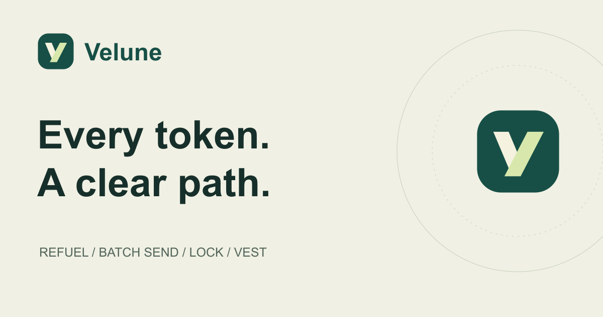
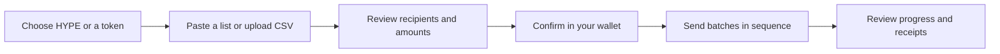
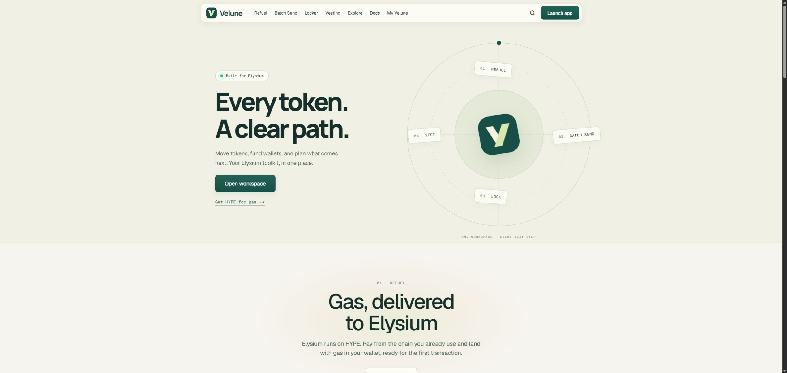
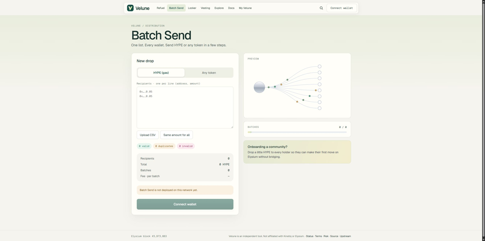
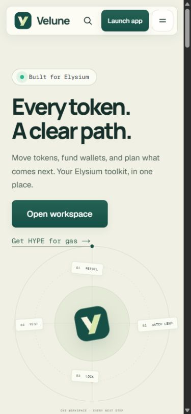

  

<strong>A workspace for moving, distributing and scheduling tokens on Elysium.</strong>

English · <a href="README.ru.md">Русский</a> 
<a href="#why-velune">Why Velune</a> · <a href="#choose-your-task">Choose your task</a> · <a href="#how-batch-send-works">How it works</a> · <a href="#see-the-product">Screenshots</a> · <a href="#questions">FAQ</a>

> **Product preview.** This repository introduces Velune through documentation and actual interface screenshots. A public application URL has not been announced here. It is not an installable application or a token sale.

## Why Velune

Getting a community ready to use a network takes more than transferring a token. New wallets need gas, distributions need a clean recipient list, liquidity may need a lock, and team allocations need a release schedule.

**Velune brings these jobs into one interface.** Start with the task you want to complete, review the amounts and conditions, then authorize the required transactions in your own wallet.

For a community organizer, that means funding many wallets from one list. For a token team, it means setting clear lock and vesting conditions. For a holder, it means inspecting those conditions and claiming tokens when they become available.

## Choose your task

| I want to… | Open | What happens |
| --- | --- | --- |
| Get HYPE for transaction fees | **Refuel** | Choose a source chain and review the available route to gas on Elysium. |
| Send HYPE or an ERC-20 token to many wallets | **Batch Send** | Paste a list or import a CSV, review recipients and totals, then confirm batches. |
| Keep tokens or liquidity locked until a date | **Locker** | Set an unlock date or a tranche plan; share a page describing the lock. |
| Release an allocation gradually | **Vesting** | Set a start, cliff and linear or periodic release schedule. |
| Check a token's locks and schedules | **Explore** | Inspect recorded locks, vesting and upcoming unlocks. |
| Manage my activity | **My Velune** | Find locks, vesting, claims and sent distributions for the connected wallet. |

**Gas** is the network fee paid to process a transaction. Elysium uses HYPE for gas. **ERC-20** is a common token standard. **Vesting** releases tokens over time; a **cliff** is the initial period during which nothing can be claimed.

## How Batch Send works

1. **Choose the asset.** Send native HYPE, or select an ERC-20 token.
2. **Add recipients.** Use a pasted list or a CSV. Each row contains a wallet and an amount; a shared amount can be applied to every wallet instead.
3. **Review before signing.** Check valid recipients, duplicates, invalid rows, the total, the number of batches and the displayed fee. Correct mistakes before proceeding.
4. **Authorize the operation.** ERC-20 transfers require a token-spending approval before sending. Wallet confirmations remain under your control.
5. **Follow the batches.** The app splits large lists into groups of **400 recipients** and sends them sequentially. The contract limit is **500 recipients per transaction**; the smaller app batch leaves gas headroom.

<strong>Walk through a small example</strong>

Imagine you want to fund three wallets for their first transactions:

| Recipient label | HYPE |
| --- | ---: |
| Wallet A | 0.05 |
| Wallet B | 0.05 |
| Wallet C | 0.10 |
| **Total distribution** | **0.20** |

The labels above are explanatory placeholders. In the app, use actual recipient addresses. The review shows three recipients and one batch. The distribution total is separate from the service fee and the network gas needed to send it.

If Wallet A appears twice, the duplicate is identified rather than silently counted twice. If a line is malformed, the interface flags it for review.

<strong>What changes with a larger list?</strong>

A list of 1,000 valid, unique recipients becomes three app batches: **400 + 400 + 200**. This is a sequence of transactions, not one atomic transfer. A completed batch remains completed if a later batch is rejected or fails. Review progress and receipts before attempting another send.

## Beyond distribution

<strong>Refuel — help a wallet make its first move</strong>

Refuel supports a bridge-route flow and an Instant flow. Instant requires configured deposit contracts, an operational relayer and HYPE available in the destination vault. Source-chain support and route availability depend on the running deployment; the screenshots are not a promise that every mode is live.

<strong>Locker — make an unlock commitment visible</strong>

Lock an ERC-20 token or supported liquidity tokens until a chosen date, or divide an allocation into up to 20 tranches. An existing lock can be extended or topped up; its unlock date cannot be shortened. The owner can withdraw when the lock becomes eligible. Public lock pages let others inspect the recorded conditions.

<strong>Vesting — turn an allocation into a schedule</strong>

Choose the recipient, start, cliff, duration and release mode. Linear schedules release over time; periodic schedules release in steps. If a schedule is created as cancellable, that condition is visible: already vested tokens remain claimable by the recipient, while the unvested portion may return to the creator on cancellation.

Recipients can use a schedule page, token claim page or My Velune to review and claim eligible tokens.

## See the product

These are screenshots of the working development preview, not simulated customer activity. Click an image to inspect it at full size.

### One workspace

### A distribution you can review

The preview has no configured sending contract, so transaction submission is unavailable in this screenshot. It demonstrates the interface rather than a live transfer.

### A layout that travels with you

## Control and visibility

- **Your wallet signs.** The interface does not ask for a seed phrase or private key. Token approvals are separate wallet authorizations.
- **Conditions matter.** Review amounts, allowances, fees, unlock dates and cancellation settings before confirming. Locks and confirmed transactions have consequences that changing the interface cannot undo.
- **On-chain activity is public.** Keeping application source private does not make blockchain transactions confidential.
- **A lock is a fact, not an endorsement.** Lock and vesting information helps inspect a token; it does not establish that the token is safe or valuable.
- **Deployment is separate from the preview.** Live transactions require configured contracts and services. Real-value transfers have not been demonstrated by the screenshots in this repository.

## Questions

<strong>Can I download and run the application from this repository?</strong>

No. This is the public product overview. Application source, build artifacts, deployment configuration, credentials and internal operational files are not included.

<strong>Is this a bridge, an exchange or a wallet?</strong>

Velune is a token-operations interface. It connects to a wallet and exposes distribution, refuel, lock, vesting and inspection workflows. Refuel can involve a bridge route. Velune does not provide a trading terminal or replace your wallet.

<strong>Does a large distribution need only one signature?</strong>

No. ERC-20 approval and each batch may require separate confirmation. The number of transactions depends on the asset and recipient count.

<strong>Where can I try the public app?</strong>

A public application URL has not been announced in this repository. Until one is added, use this page to explore the product and its workflows.

<strong>Is Velune affiliated with Elysium or Kinetiq?</strong>

Velune is an independent interface for the Elysium ecosystem. This page does not claim endorsement or affiliation with Elysium or Kinetiq.

---

**Velune — Every token. A clear path.**

[Back to top](#) · [Русская версия](README.ru.md) · [Repository contents and rights](NOTICE.md)
