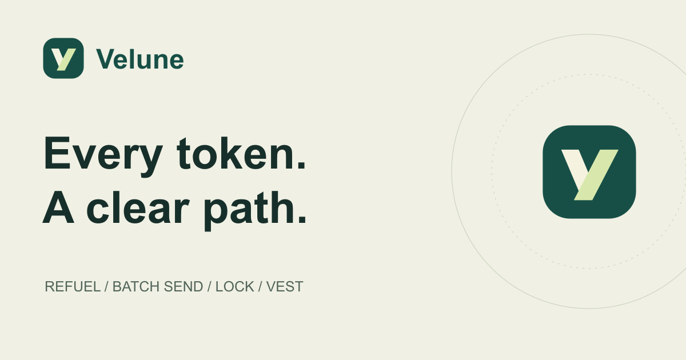
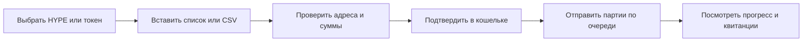
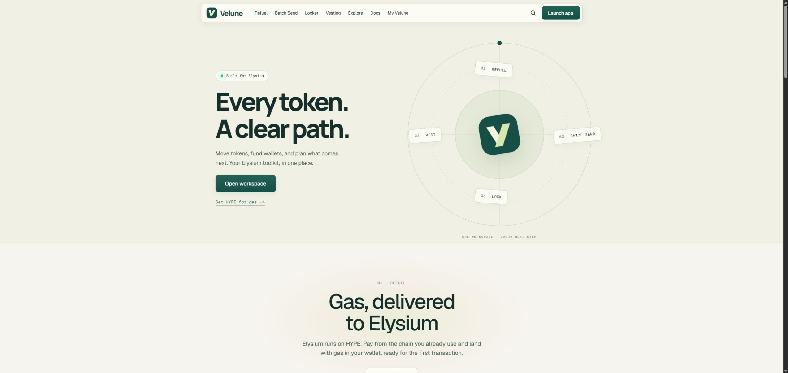
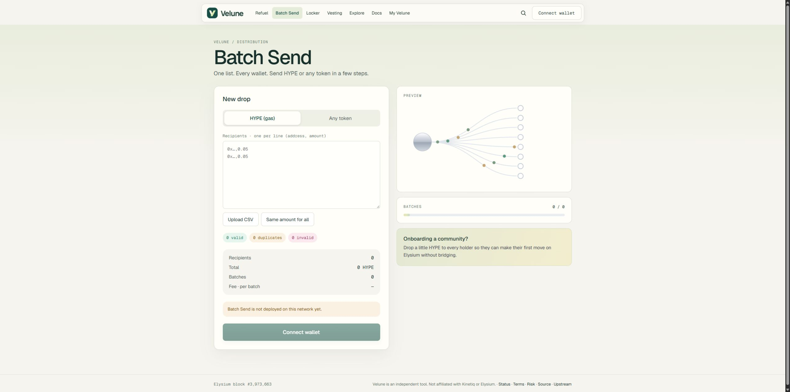
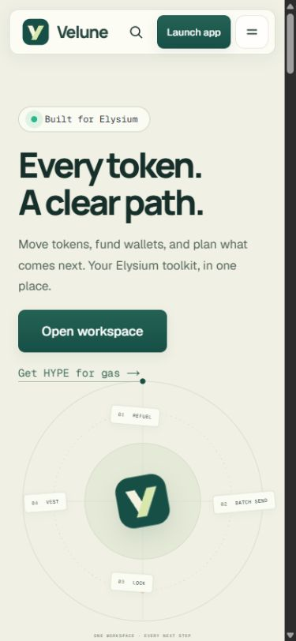

<strong>Единое приложение для отправки, распределения, блокировки и постепенного выпуска токенов в Elysium.</strong>

<a href="README.md">English</a> · Русский 
<a href="#зачем-нужен-velune">Зачем нужен</a> · <a href="#выберите-задачу">Возможности</a> · <a href="#как-работает-batch-send">Как работает</a> · <a href="#интерфейс">Скриншоты</a> · <a href="#вопросы-и-ответы">Вопросы</a>

> **Обзор продукта.** В репозитории опубликованы описание и реальные скриншоты версии для разработки. Адрес публичного приложения пока не объявлен. Этот репозиторий не является установочным пакетом или предложением купить токен.

## Зачем нужен Velune

Чтобы сообщество начало пользоваться сетью, одного токена мало. Кошелькам нужен газ, массовой рассылке — проверенный список адресов, ликвидности — понятные условия блокировки, а распределению команды — график разблокировки.

**Velune объединяет эти задачи в одном интерфейсе.** Пользователь выбирает действие, проверяет суммы и условия, а затем подтверждает нужные транзакции в собственном кошельке.

Организатор сообщества может распределить газ между участниками. Команда — задать блокировку и график выпуска токенов. Получатель — посмотреть условия и забрать доступную часть своей доли.

## Выберите задачу

| Что нужно сделать | Раздел | Результат |
| --- | --- | --- |
| Получить HYPE для оплаты транзакций | **Refuel** | Выбор исходной сети и доступного маршрута пополнения газа в Elysium. |
| Отправить HYPE или ERC-20 многим кошелькам | **Batch Send** | Загрузка списка или CSV, проверка получателей, отправка партиями. |
| Заблокировать токены или ликвидность | **Locker** | Дата разблокировки или несколько траншей и страница с условиями. |
| Выпускать выделенную долю постепенно | **Vesting** | Дата начала, период ожидания и линейный либо периодический выпуск. |
| Изучить блокировки и графики токена | **Explore** | Обзор записанных в сети условий и предстоящих разблокировок. |
| Посмотреть собственные операции | **My Velune** | Блокировки, графики, доступные к получению токены и рассылки подключённого кошелька. |

**Газ** — плата сети за обработку транзакции; в Elysium для этого используется HYPE. **ERC-20** — распространённый стандарт токенов. **Вестинг** — постепенная разблокировка. **Cliff** — начальный период, в течение которого токены ещё нельзя получить.

## Как работает Batch Send

1. **Выберите актив:** HYPE или ERC-20.
2. **Добавьте получателей:** вставьте список или загрузите CSV с адресом и суммой в каждой строке. Можно задать одинаковую сумму всем.
3. **Проверьте расчёт:** корректные строки, дубликаты, ошибки, итоговую сумму, количество партий и комиссию. Исправьте ошибки до отправки.
4. **Подтвердите действие:** для ERC-20 сначала потребуется разрешение на расходование токенов, затем подтверждения отправки.
5. **Следите за партиями:** приложение отправляет по **400 получателей**, сохраняя запас относительно лимита контракта в **500 получателей за транзакцию**.

<strong>Развернуть пример небольшой рассылки</strong>

Предположим, нужно дать трём участникам немного газа:

| Получатель | HYPE |
| --- | ---: |
| Кошелёк A | 0,05 |
| Кошелёк B | 0,05 |
| Кошелёк C | 0,10 |
| **Итого получателям** | **0,20** |

В таблице условные обозначения; в приложении используются настоящие адреса. Перед отправкой будут показаны три получателя и одна партия. Комиссия сервиса и газ сети учитываются отдельно от суммы получателям.

Повторный адрес будет отмечен как дубликат, а строка неправильного формата — как ошибка. Для чисел в CSV используется точка, например `0.05`.

<strong>Что будет со списком на 1 000 кошельков?</strong>

Для 1 000 корректных уникальных адресов приложение сформирует три партии: **400 + 400 + 200**. Это несколько отдельных транзакций. Если поздняя партия не отправилась, ранее подтверждённые партии остаются выполненными. Перед повторной отправкой нужно проверить прогресс и квитанции.

## Другие возможности

<strong>Refuel: газ для первой транзакции</strong>

Есть маршрут через мост и режим Instant. Для Instant нужны настроенные депозитные контракты, работающий сервис доставки и запас HYPE в сети назначения. Доступные сети и режимы зависят от действующего развёртывания. Скриншот интерфейса не означает, что все маршруты уже запущены.

<strong>Locker: условия блокировки, которые можно проверить</strong>

Токены ERC-20 или поддерживаемые токены ликвидности можно заблокировать до даты либо распределить по плану до 20 траншей. Блокировку можно продлить или пополнить, но нельзя сократить её срок. Вывод доступен владельцу после наступления условий разблокировки. На публичной странице видны записанные условия.

<strong>Vesting: выпуск доли по расписанию</strong>

Задайте получателя, начало, cliff, длительность и режим выпуска. Линейный выпуск идёт постепенно, периодический — отдельными шагами. Возможность отмены выбирается при создании и видна получателям. При отмене уже разблокированная доля остаётся получателю, а ещё не разблокированная может вернуться создателю.

Получить доступные токены можно через страницу графика, общую страницу получения токена или My Velune.

## Интерфейс

Реальные скриншоты версии для разработки. Нажмите на изображение, чтобы открыть полный размер.

### Обзор инструментов

### Подготовка массовой отправки

В показанной версии не настроен контракт отправки, поэтому выполнение транзакций недоступно. Скриншот демонстрирует интерфейс, а не реальную рассылку.

### Мобильная версия

## Что остаётся под вашим контролем

- **Кошелёк подписывает операции.** Интерфейс не запрашивает seed-фразу или приватный ключ. Разрешение на расходование токена подтверждается отдельно.
- **Условия нужно проверять.** Суммы, разрешения, комиссии, даты и возможность отмены важны до подписи. Изменение интерфейса не отменяет подтверждённую транзакцию.
- **Действия в блокчейне публичны.** Закрытые исходники приложения не делают переводы конфиденциальными.
- **Блокировка не гарантирует качество токена.** Она помогает проверить конкретный факт, а не обещает безопасность или доходность.
- **Обзор и действующий сервис — разные этапы.** Для реальных операций нужны настроенные контракты и службы. Скриншоты не подтверждают проведение переводов с реальными средствами.

## Вопросы и ответы

<strong>Можно скачать приложение из этого репозитория?</strong>

Здесь опубликован только обзор продукта. Исходники, сборки приложения, настройки развёртывания, учётные данные и внутренние рабочие файлы не включены.

<strong>Это кошелёк, биржа или мост?</strong>

Velune — интерфейс для операций с токенами. Он подключается к кошельку и предлагает распределение, пополнение газа, блокировки, вестинг и просмотр условий. В Refuel может использоваться маршрут через мост. Приложение не заменяет кошелёк и не является торговым терминалом.

<strong>Для рассылки достаточно одной подписи?</strong>

Не всегда. Разрешение ERC-20 и каждая партия могут требовать отдельных подтверждений. Количество транзакций зависит от актива и числа получателей.

<strong>Где открыть публичное приложение?</strong>

Адрес публичного приложения в этом репозитории пока не объявлен. Сейчас здесь можно познакомиться с возможностями и последовательностью действий.

<strong>Есть ли официальная связь с Elysium или Kinetiq?</strong>

Velune — независимый интерфейс для экосистемы Elysium. Этот обзор не заявляет официального партнёрства или одобрения со стороны Elysium либо Kinetiq.

---

**Velune — Every token. A clear path.**

[Наверх](#) · [English](README.md) · [Состав репозитория и права](NOTICE.md)
